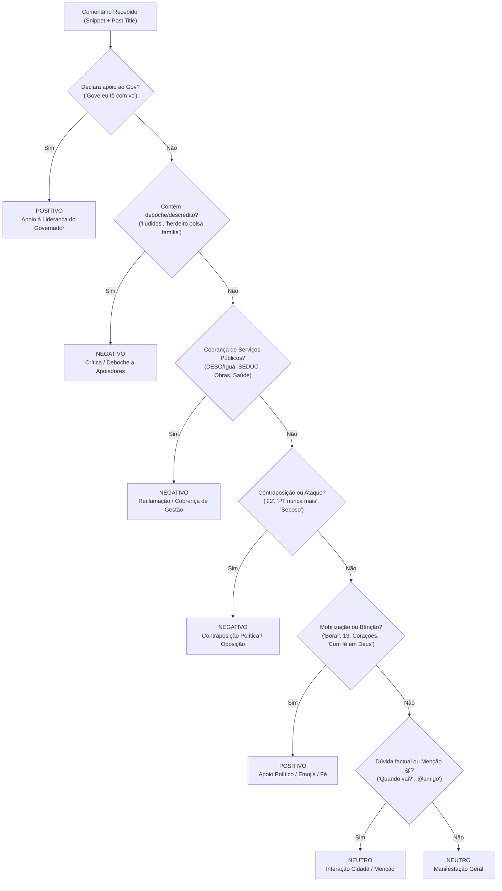

# MANUAL DE DIRETRIZES DE SENTIMENTALIZAÇÃO CONTEXTUAL DE REDES SOCIAIS
## Inteligência de Sentimento, Análise Política e Reputação Governamental
**Lagos Data Intelligence** · Documento Normativo e Base de Conhecimento  
**Cliente:** Governo de Sergipe (SECOM) · **Liderança Analisada:** Governador Fábio Mitidieri  
**Artefatos Relacionados:** [`classificacao_comentarios_amostra.csv`](file:///c:/Users/Lagos/Documents/Limpeza-BW/classificacao_comentarios_amostra.csv) | [`core/claude_analyzer.py`](file:///c:/Users/Lagos/Documents/Limpeza-BW/core/claude_analyzer.py)

---

## 1. Princípios Metodológicos Fundamentais

A sentimentalização de redes sociais no contexto de comunicação pública e inteligência política não segue a lógica comercial de consumo (como avaliações de e-commerce). Ela exige a compreensão de **três princípios reitores**:

### 1.1. Princípio da Prevalência do Alvo Governamental Estadual
O sujeito primário da reputação é o **Governador Fábio Mitidieri** e as políticas públicas do Estado de Sergipe.
* Quando um comentário manifesta lealdade e afeto ao Governador, mas expressa discordância de seus aliados ou alianças federais, **prevalece o apoio à liderança estadual**.
* *Exemplo Doutrinário:* `"Gove eu tô com vc, mas tá na hora de aposentar seu presi. ❤️"`  
  * Análise Tradicional de Mercado: Erroneamente marcada como Neutra ou Negativa por conter *"aposentar seu presi"*.  
  * **Classificação Lagos:** **POSITIVO** (Subtema: *Apoio à Liderança do Governador com Ressalva Política*), pois o vínculo declarado de confiança é direto com o Governador (*"eu tô com você"* + coração).

### 1.2. Princípio da Dependência Contextual da Postagem-Mãe (Parent Context)
Nenhum comentário existe isolado na tela. A intenção de voto ou manifestação curta adquire polaridade em função da postagem onde foi inserida:
* Uma menção de oposição eleitoral (`"22"`, `"Flávio 22"`, `"Bora 22"`, `"2️⃣2️⃣"`) postada em um canal institucional do Governador que noticia um ato de campanha aliada (`13` / Luiz Roberto / Lula) configura **CONTRAPOSIÇÃO POLÍTICA** e deve ser pontuada como **NEGATIVO**.
* Já números de urna e slogans da base aliada (`"13"`, `"1313"`, `"Lula neles 13"`, `"#boralula"`) nessas postagens constituem **APOIO POLÍTICO ALINHADO** e devem ser pontuados como **POSITIVO**.

### 1.3. Princípio da Distinção entre Forma Estrutural e Sentimento
A análise separa rigorosamente a forma do conteúdo:
1. **Comentário com Conteúdo Escrito:** Traz frases, queixas de serviços públicos, elogios textuais ou críticas elaboradas.
2. **Comentário com Apenas Emojis / Siglas:** Manifestações puramente visuais, códigos de urna ou sequências gráficas, que demandam decodificação semiótica específica.

---

## 2. Base de Conhecimento e Dicionário de Decisão

A tabela a seguir consolida as diretrizes definitivas estabelecidas para cada tipologia de comentário:

| Padrão / Exemplo | Classificação Oficial | Categoria Estrutural | Justificativa Analítica e Conceitual |
| :--- | :---: | :--- | :--- |
| **`🇧🇷🇧🇷🇧🇷❤️`** | **Positivo** | Emojis / Siglas | Combinação da bandeira nacional com o coração. Expressa patriotismo afetuoso, civismo positivo e apreço à publicação oficial. |
| **`Bora!!!` / `Bora` / `Boraaa gente!! ⭐️♥️💙`** | **Positivo** | Conteúdo Escrito | Expressão popular de entusiasmo, convocação ativa e engajamento favorável ao ato ou projeto divulgado. |
| **`1313❤️❤️❤️❤️❤️` / `13LULA ❤️❤️`** | **Positivo** | Emojis / Conteúdo | Associação explícita do número e nome da chapa apoiada com múltiplos corações e símbolos de carinho. |
| **`👏👏👏👏` / `👏👏👏👏🙌❤️`** | **Positivo** | Emojis / Siglas | Palmas isoladas ou combinadas com oração e corações. Representam endosso, comemoração e aplauso à ação governamental. |
| **`Lula neles 13` / `#boralula` / `Aqui é Lulaaaaaaaa ♥️⭐🇧🇷`** | **Positivo** | Conteúdo Escrito | Alinhamento político direto com o grupo governista. Fortalece a mobilização da base aliada nas redes do governador. |
| **`❤️❤️❤️❤️`** | **Positivo** | Emojis / Siglas | Sequência de corações. Expressa afeto puro, gratidão e simpatia imediata pelo conteúdo veiculado. |
| **`Com fé em Deus` / `Deus abençoe vcs`** | **Positivo** | Conteúdo Escrito | Manifestação religiosa tradicional de proteção, bênção e voto de sucesso à liderança e às famílias presentes. |
| **`Gove eu tô com vc, mas tá na hora de aposentar seu presi. ❤️`** | **Positivo** | Conteúdo Escrito | O eleitor declara explicitamente estar com o Governador (*"eu tô com vc"*). O apoio à liderança estadual sobrepõe-se à divergência federal. |
| **`Iludidos 🤭`** | **Negativo** | Conteúdo Escrito | Deboche e descrédito desqualificando os cidadãos presentes ou a narrativa apresentada pelo governo. |
| **`Só os que não trabalham em horário de herdeiro do bolsa família. 😂`** | **Negativo** | Conteúdo Escrito | Ataque classista e pejorativo aos cidadãos beneficiários e participantes do evento público. |
| **`22` / `Flávio 22` / `22flavio 👏👏👏👏👏` / `2️⃣2️⃣`** | **Negativo** | Emojis / Conteúdo | Contraposição eleitoral explícita inserida nos canais oficiais do Governador para rivalizar com a postagem governista. |
| **`Miti cadê a água do Ponto Novo` / `4 dias sem água no Tamandaré`** | **Negativo** | Conteúdo Escrito | Cobrança incisiva de serviço público essencial (Saneamento / DESO / Iguá). Alto risco de desgaste de imagem. |
| **`Essa premiação das injustiças e mentiras (SEDUC)`** | **Negativo** | Conteúdo Escrito | Crítica direta aos critérios de concessão do Prêmio Educação Nota 10 e demandas salariais da categoria de professores. |
| **`Tem que da os parabéns e desta pra pior @fabiogov55`** | **Negativo** | Conteúdo Escrito | Sarcasmo e ironia denunciando a degradação dos serviços públicos concessionados. |
| **`🤢` / `🤮` / `😡` / `👎`** | **Negativo** | Emojis / Siglas | Emojis de repulsa, náusea e reprovação explícita à figura pública ou ao projeto. |
| **`@maria_aracaju @joao_se`** | **Neutro** | Conteúdo Escrito | Marcação pura de outros perfis sem manifestação de opinião ou sentimento. |
| **`Quando vai sair o resultado?` / `Vai ter VLT?`** | **Neutro** | Conteúdo Escrito | Dúvida factual ou solicitação de informação cidadã sem carga crítica agressiva. |

---

## 3. Matriz Comparativa: Classificação Genérica vs. Skill Lagos

A tabela abaixo demonstra as distorções frequentes geradas por ferramentas genéricas de NLP (ex: Brandwatch) e como a Skill de Sentimentalização Governamental da Lagos corrige cada desvio:

```
┌────────────────────────────────────────────────────────┬─────────────┬─────────────┬────────────────────────────────────────────────────────┐
│ Comentário Cidadão Real                                │ Brandwatch  │ Skill Lagos │ Motivo da Correção Especializada                       │
├────────────────────────────────────────────────────────┼─────────────┼─────────────┼────────────────────────────────────────────────────────┤
│ "Iludidos 🤭"                                          │ Positivo ❌ │ Negativo 🟢 │ O emoji '🤭' confunde o NLP genérico; é deboche claro. │
│ "Só os que não trabalham em horário de herdeiro..."    │ Positivo ❌ │ Negativo 🟢 │ O riso '😂' mascara o ataque político e classista.     │
│ "22flavio 👏👏👏👏👏👏"                                │ Positivo ❌ │ Negativo 🟢 │ Palmas pró-oposição em canal governista = oposição.    │
│ "Miti cadê a água do Ponto Novo, Eu te amo tanto😍❤️"  │ Positivo ❌ │ Negativo 🟢 │ O afeto pessoal não anula a cobrança de falta d'água.  │
│ "Gove eu tô com vc, mas aposente seu presi ❤️"         │ Neutro ❌   │ Positivo 🟢 │ Lealdade declarada ao Governador Fábio Mitidieri.      │
│ "1313❤️❤️❤️❤️❤️"                                       │ Neutro ❌   │ Positivo 🟢 │ O NLP genérico ignora código de urna com corações.     │
│ "Boraaa gente!! ⭐️♥️💙"                                │ Neutro ❌   │ Positivo 🟢 │ Entusiasmo e mobilização cidadã pró-governo.           │
│ "Com fé em Deus"                                       │ Neutro ❌   │ Positivo 🟢 │ Voto religioso tradicional de bênção ao líder público. │
│ "🇧🇷🇧🇷🇧🇷❤️"                                             │ Neutro ❌   │ Positivo 🟢 │ Patriotismo cívico afetuoso direcionado ao Estado.     │
└────────────────────────────────────────────────────────┴─────────────┴─────────────┴────────────────────────────────────────────────────────┘
```

---

## 4. Estrutura de Regras Heurísticas (Regex & Lógica Python)

Para garantir execução determinística e imediata sem dependência contínua de custos de API externa, o script [`scratch/classificar_amostra.py`](file:///c:/Users/Lagos/Documents/Limpeza-BW/scratch/classificar_amostra.py) implementa a seguinte hierarquia de decisão:



### Expressões Regulares de Referência (Extrato Operacional):
```python
# 1. Apoio à Liderança Estadual
REGEX_APOIO_GOV = r'\b(gove?\s+eu\s+t[oô]\s+com\s+vc|t[oô]\s+com\s+f[aá]bio|tamo\s+junto\s+meu\s+gov)\b'

# 2. Deboche e Descrédito
REGEX_DEBOCHE = r'\b(iludidos|bolsa fam[ií]lia|hor[aá]rio de herdeiro|n[aã]o morra seja s[oó] um susto|de tr[eê]s capotadas)\b'

# 3. Contraposição Eleitoral ao Post
REGEX_OPOSICAO_22 = r'\b22\b|2222+|2️⃣2️⃣|fl[aá]vio\s*22|22\s*fl[aá]vio'

# 4. Mobilização e Conclamação Favorável
REGEX_MOBILIZACAO = r'\b(bora+|boralula|bora\s*lula|bora\s*virar|lula\s*neles|aqui\s+[eé]\s+lula|lula\s*13|13\s*lula|1313|é\s*13|sou\s*13)\b|#boralula|1313|1️⃣3️⃣'

# 5. Manifestações de Bênção e Fé
REGEX_FE = r'\b(com\s+f[eé]\s+em\s+deus|deus\s+aben[cç]oe|deus\s+te\s+aben[cç]oe|deus\s+te\s+ilumine|deus\s+no\s+comando|am[eé]m|gl[oó]ria\s+a\s+deus)\b'
```

---

## 5. Distribuição Estatística Consolidada da Amostra (317 Menções)

Com a incorporação da base de conhecimento validada pelo usuário, a base de teste de 317 menções atingiu a seguinte consolidação analítica:

### 5.1. Síntese por Sentimento Contextual
* **Positivo:** **166 menções (52,4%)**  
  * *Composição:* Mobilização eleitoral pró-governo (83), Emojis de aplauso e corações (59), Elogios textuais à gestão (18), Votos de fé e bênção (5), Apoio direto ao governador (1).
* **Neutro:** **77 menções (24,3%)**  
  * *Composição:* Manifestações gerais e comentários descritivos (38), Emojis neutros/indeterminados (24), Marcações de amigos (11), Dúvidas de serviço (4).
* **Negativo:** **74 menções (23,3%)**  
  * *Composição:* Contraposição eleitoral / Voto 22 (32), Reclamações de serviços públicos essenciais (28), Críticas partidárias diretas (10), Deboche a apoiadores (3), Emoji de repulsa (1).

### 5.2. Síntese por Categoria Estrutural
* **Comentário com Conteúdo Escrito:** 239 comentários (75,4%)
* **Comentário com Apenas Emojis / Siglas:** 78 comentários (24,6%)

---

## 6. Diretrizes para Enriquecimento do Prompt Cognitivo (Claude Analyzer)

Para que a camada de IA via API do Claude (`claude-3-7-sonnet`) replique essas decisões com total fidelidade quando ativada, a seção de regras contextuais do prompt deve sempre conter:

> **Regra de Soberania do Governador:** Se o usuário elogiar ou declarar lealdade a Fábio Mitidieri ("Gove tô com você"), classifique como **Positivo**, mesmo se ele tecer críticas paralelas a políticos nacionais.  
> **Regra de Conclamação:** Termos de incentivo e presença como *"Bora!"*, *"Estaremos lá"*, *"Com fé em Deus"* e corações são **Positivos**.  
> **Regra de Emojis Combinados:** Bandeiras nacionais com corações (`🇧🇷❤️`) e aplausos múltiplos (`👏👏👏`) são manifestações **Positivas**.  
> **Regra de Sarcasmo e Deboche:** Mensagens irônicas que usam risos (`😂`, `🤭`) para desqualificar eleitores ou serviços são **Negativas**.  
> **Regra de Oposição Eleitoral:** Qualquer referência ao número da oposição (`22`) em postagens governistas é **Negativa** (Contraposição Política).
